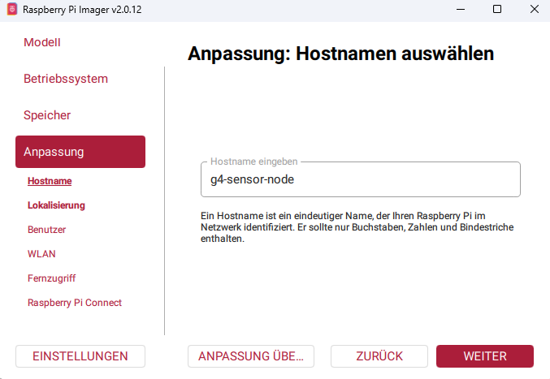
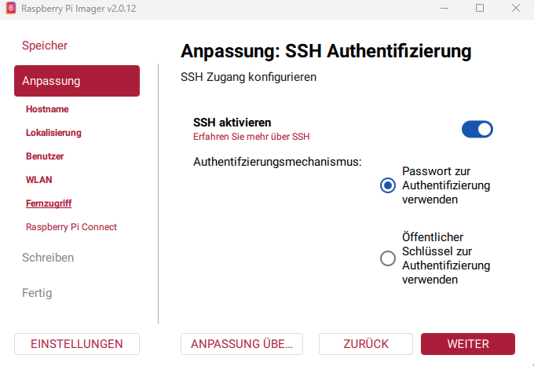
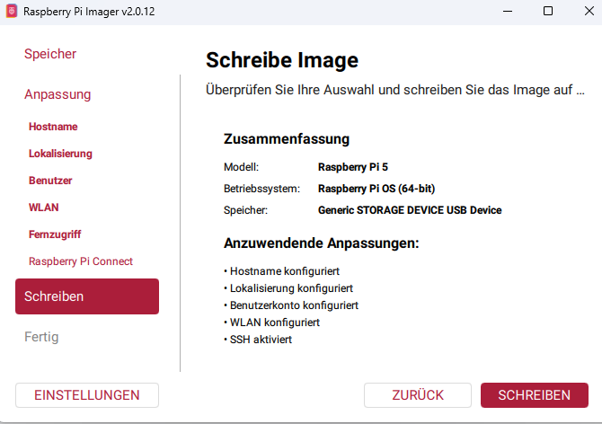
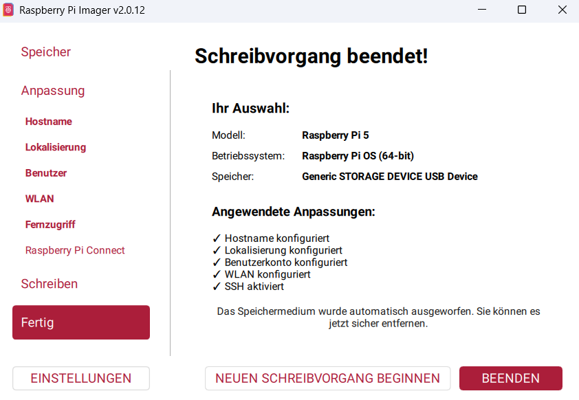
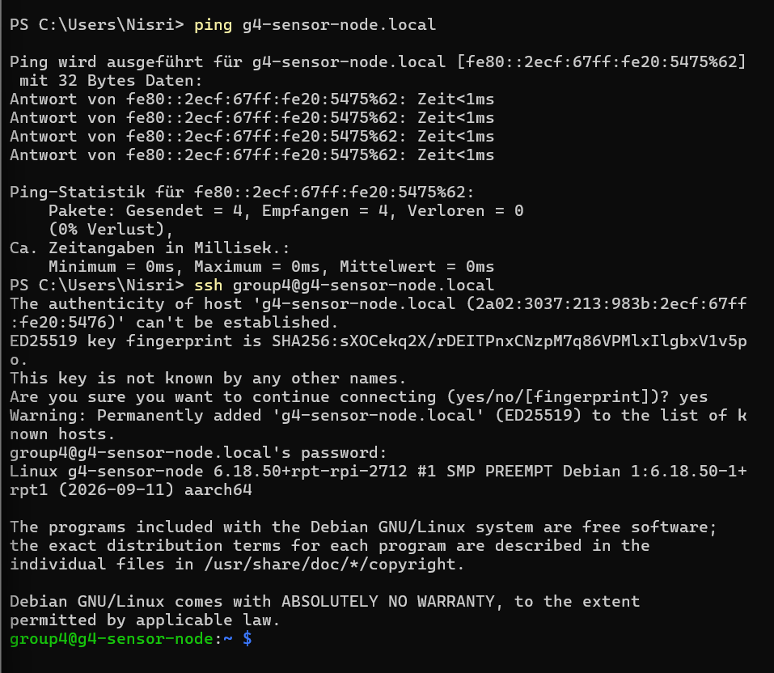

# Part A – Setting up the Raspberry Pi 5 (Sensor Node)

**Task 1 – Sensor node & cameras** · Author: Nisrine · Date: 29–30 Oct 2026

## Goal

Prepare the Raspberry Pi 5 so that it boots, is reachable from a laptop via SSH,
is up to date, detects the AI HAT+, and has the group repository cloned.

## Hardware used

| Component | Notes |
|---|---|
| Raspberry Pi 5 (8 GB RAM) | In black case with power button |
| Raspberry Pi AI HAT+ | Pre-installed (Hailo-8 AI processor) |
| Raspberry Pi 27W USB-C Power Supply | |
| MicroSD card, 32 GB (Samsung PRO) | Boot medium |
| USB 3.0 card reader (LogiLink) | For writing the card on the laptop |
| LogiLink USB-C 3-port hub with Gigabit Ethernet | For a direct cable connection laptop ↔ Pi |
| RJ45 network cable | |
| Micro-HDMI to HDMI cable + monitor | Only used for troubleshooting |

Laptop: Windows 11. Network: iPhone personal hotspot and university Wi-Fi.

## Step 1 – Write the operating system to the MicroSD card

1. Install **Raspberry Pi Imager** (v2.0.12) from https://www.raspberrypi.com/software/.
2. Insert the MicroSD card into the card reader and connect it to the laptop.
3. In the Imager, choose:
   - **Device:** Raspberry Pi 5
   - **OS:** Raspberry Pi OS (64-bit) (with desktop, useful for troubleshooting with a monitor)
   - **Storage:** the card reader ("Generic STORAGE DEVICE USB Device").
     Tick **"Exclude system drives"** so the laptop's internal disk cannot be selected by mistake.
4. Customisation:

| Setting | Value |
|---|---|
| Hostname | `g4-sensor-node` (group number added to avoid name conflicts with other groups) |
| Time zone / keyboard | `Europe/Berlin` / `de` |
| User | `group4` (password shared within the team only, not documented) |
| Wi-Fi | iPhone personal hotspot (WPA2) |
| SSH | Enabled, password authentication |
| Raspberry Pi Connect | Disabled |





5. Click **Write** and wait until "Write successful" appears.



> **Note:** Over the dormitory Wi-Fi, downloading and writing the image took several hours.
> On the university network it was much faster.

## Step 2 – First boot

1. Insert the MicroSD card into the slot on the underside of the Pi
   (short edge opposite the USB ports, label facing down).
2. Connect the 27W power supply. The green LED flickers while booting.
3. Wait 3–5 minutes. The first boot takes longer because the system configures itself.

> **Tip (iPhone hotspot):** Enable **"Maximize Compatibility"** and keep the hotspot
> settings page open while the Pi boots, otherwise the Pi may not find the network.

## Step 3 – Connect via SSH

### Direct cable connection (fallback that always works)

If the Pi is not found over Wi-Fi, connect it directly to the laptop:

1. Connect the USB-C hub to the laptop and the RJ45 cable from the hub to the Pi.
2. On Windows: `Win + R` → `ncpa.cpl` → right-click the Wi-Fi adapter → **Properties** →
   **Sharing** → tick *"Allow other network users to connect through this computer's
   Internet connection"* → select the hub's Ethernet adapter → **OK**.
3. Restart the Pi (unplug, wait 5 s, plug in), wait 2 minutes.
4. Test: `ping g4-sensor-node.local`

Windows Internet Connection Sharing assigns addresses in the range `192.168.137.x`
to the Pi, and it also gives the Pi internet access through the laptop.

### Log in

```powershell
ssh group4@g4-sensor-node.local
```

Answer `yes` to the fingerprint question on the first connection, then enter the password
(nothing is shown while typing).



System information shown at login: Raspberry Pi OS (Debian-based), kernel 6.18.50, `aarch64`.

### Check the network addresses

```bash
hostname -I
```

Result in our setup: one address via cable (`192.168.137.x`) and one via the iPhone
hotspot (`172.20.10.x`). This showed that Wi-Fi was working as well.
Addresses can change after a restart; the hostname `g4-sensor-node.local` can be used instead.

## Step 4 – Update the system

To avoid using mobile data, the laptop was connected to the university Wi-Fi and
shared its connection with the Pi over the cable.

```bash
sudo apt update && sudo apt full-upgrade -y
sudo reboot
```

## Step 5 – Check the AI HAT+

```bash
lspci
```

Result:

```
0001:01:00.0 Co-processor: Hailo Technologies Ltd. Hailo-8 AI Processor (rev 01)
```

The AI HAT+ is detected (Hailo-8). The Hailo software is not installed yet;
it will be needed once the AI model (Task 2) runs on the Pi.

## Step 6 – Clone the group repository

The repository is private, so the Pi must log in to GitHub first. We use GitHub CLI:

```bash
sudo apt install gh -y
gh auth login
# GitHub.com → HTTPS → Yes → Login with a web browser
# Enter the one-time code on the laptop at https://github.com/login/device
gh repo clone NisrineELY/cloud-computing-group4-ws2627
```

> **Note:** If `gh` opens a text browser inside the SSH session, quit it with `q`
> and enter the code on the laptop instead. To avoid this, run
> `GH_BROWSER=false gh auth login`.
>
> The GitHub credentials are stored in plain text on the Pi. Anyone who can log in as
> `group4` can use this GitHub access, so the Pi password is shared within the team only.

## Shutting down safely

```bash
sudo shutdown -h now
```

Wait until the green LED is off before unplugging the power supply.

## Problems and solutions

| Problem | Cause | Solution |
|---|---|---|
| Writing the card took several hours | Slow dormitory Wi-Fi | Write the card on the university network |
| Pi did not connect to the dormitory Wi-Fi (network icon crossed out on the desktop) | Not investigated further | Re-wrote the card with the iPhone hotspot as Wi-Fi |
| `ping g4-sensor-node.local` failed over the hotspot | Pi not yet ready / name not resolved via hotspot | Direct cable connection with Windows Internet Connection Sharing; later confirmed that the hotspot works too |
| `gh auth login` opened a text browser in the terminal | No graphical browser over SSH | Quit with `q`, enter the code on the laptop |

## Result

The Raspberry Pi 5 runs Raspberry Pi OS (64-bit), is reachable via SSH as
`g4-sensor-node`, is up to date, detects the AI HAT+ (Hailo-8), and has the group
repository cloned. Next: **Part B – connecting and testing the cameras.**
