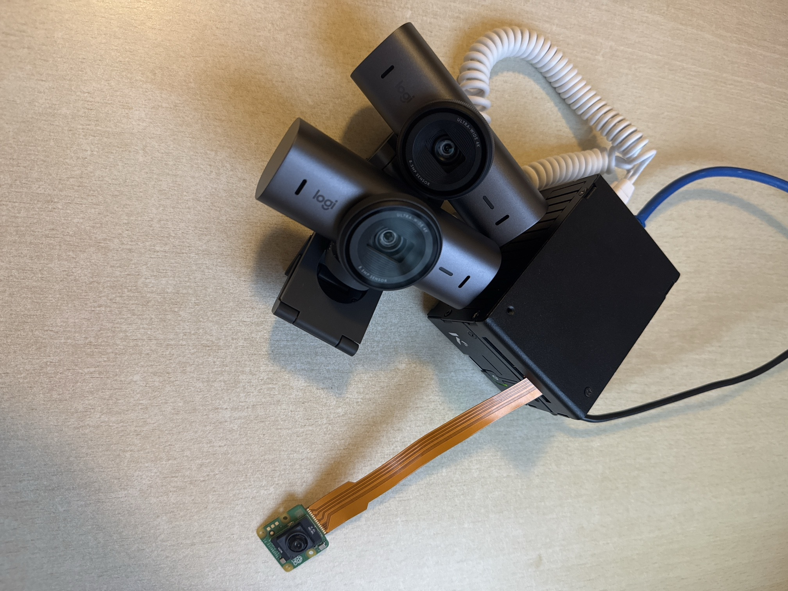
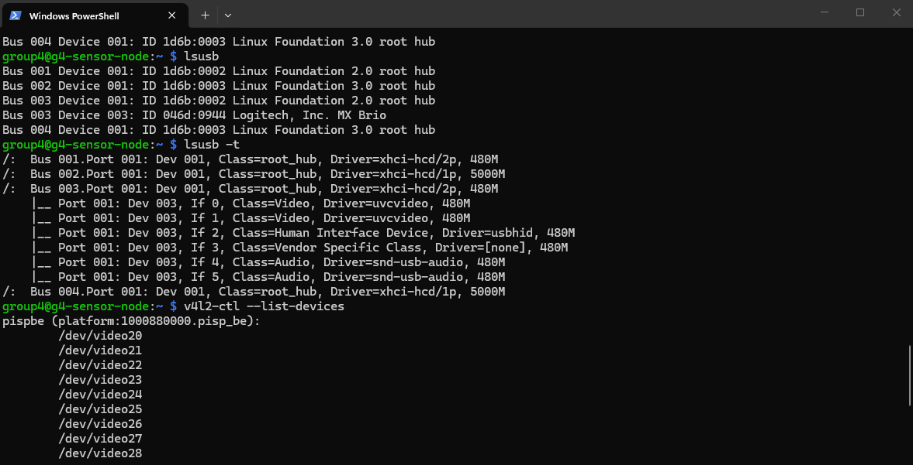
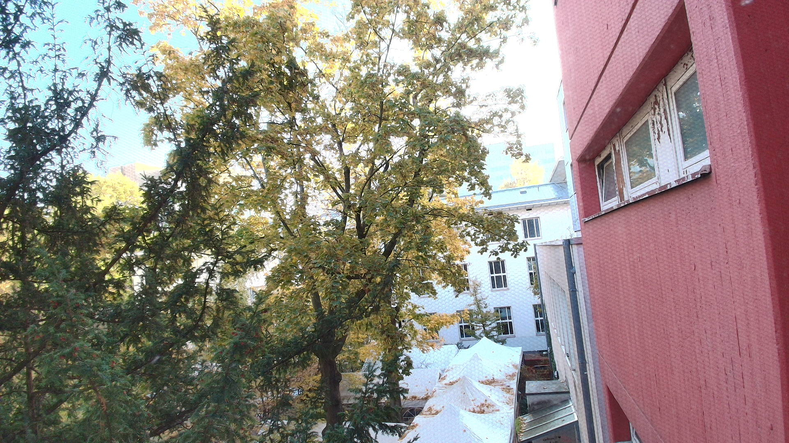
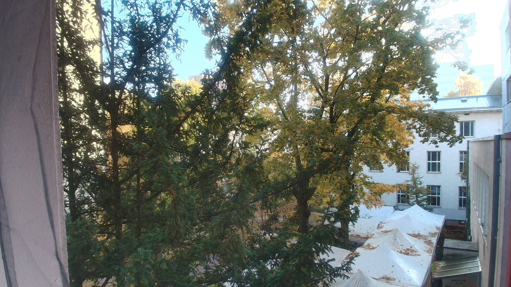
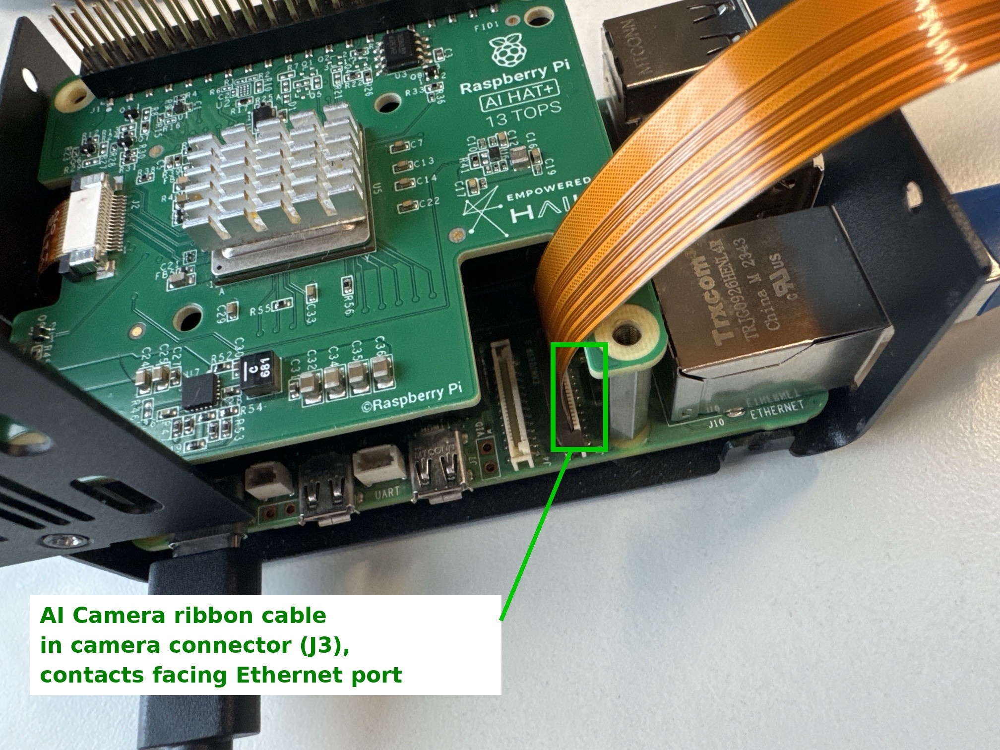
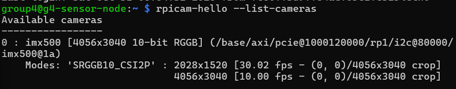
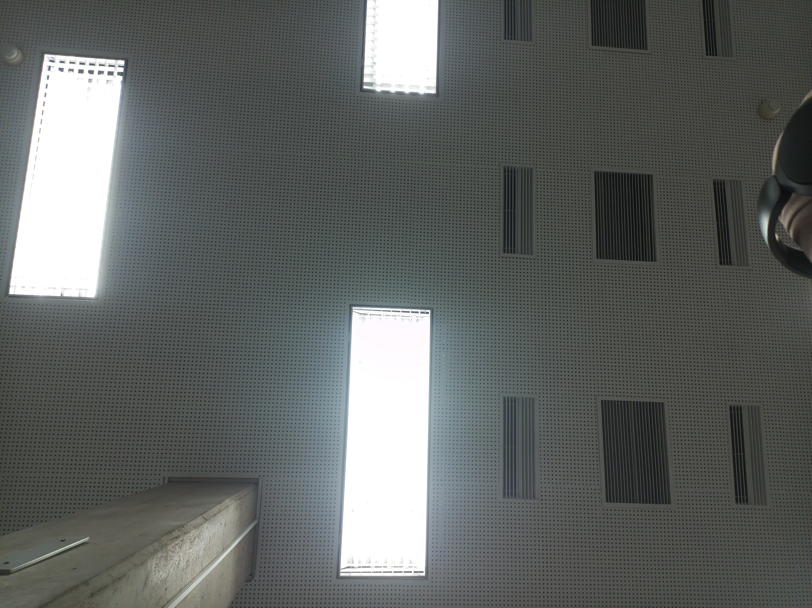
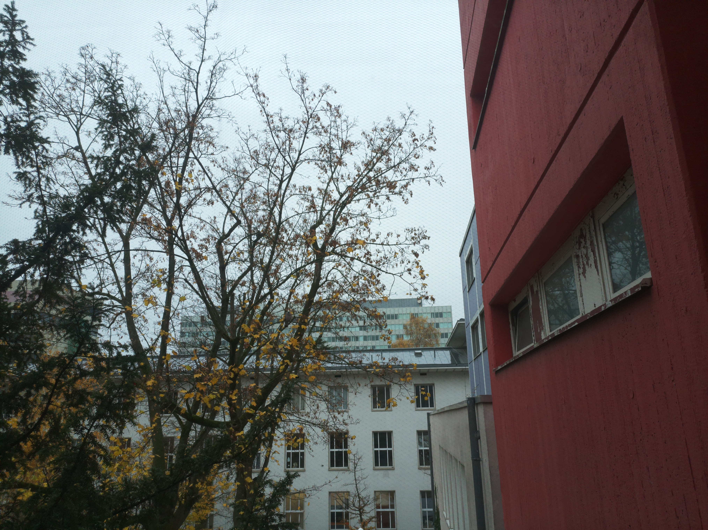
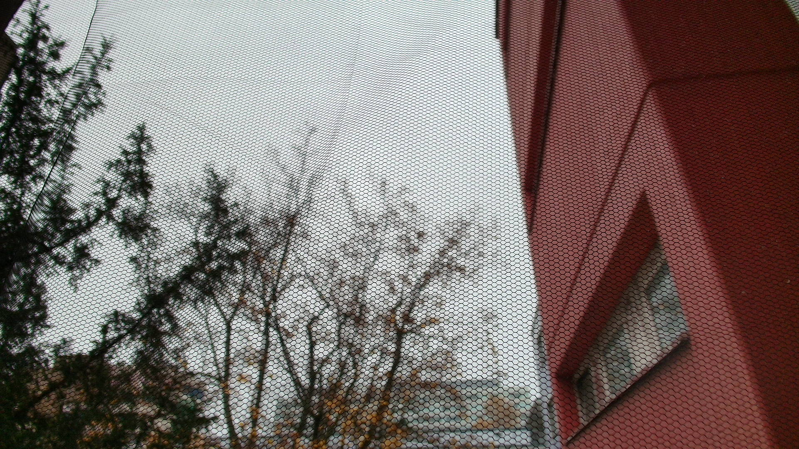
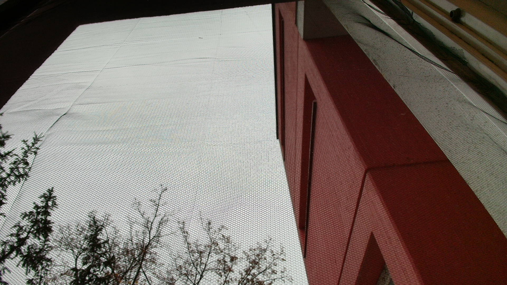

# Task 1 – Part B: Connecting and Testing the Cameras

**Goal:** Every camera of the sensor node delivers a test image, on its own and with all cameras running at the same time. We also recorded the resolutions and frame rates each camera supports, as a basis for the program in Part C and the measurements in Part E.

**Status:** Done (30.10. – 19.11.2026)



---

## 1. Hardware and connections

| Camera | Interface | Connected to | Cable |
|---|---|---|---|
| Logitech MX Brio 1 | USB | blue USB port (`xhci-hcd.1-1`) | USB-C → USB-A (USB 2.0) |
| Logitech MX Brio 2 | USB | blue USB port (`xhci-hcd.0-1`) | USB-C → USB-A (USB 2.0) |
| Raspberry Pi AI Camera (Sony IMX500) | CSI (ribbon cable) | camera connector J3 on the Pi 5 | Raspberry Pi Camera Cable **Standard – Mini**, 200 mm |

The Raspberry Pi 5 runs Raspberry Pi OS (64-bit) with the AI HAT+ (Hailo-8) mounted on top (see Part A).

## 2. Preparation

### Network connection

The Pi is connected by network cable to the laptop (LogiLink USB-C hub) and gets internet through Windows Internet Connection Sharing (address `192.168.137.x`).

Windows Internet Connection Sharing only forwards **IPv4**. `ping google.com` fails because Linux tries IPv6 first; `ping -4 google.com` works. Package installation is therefore forced to IPv4:

```bash
sudo apt -o Acquire::ForceIPv4=true update
sudo apt -o Acquire::ForceIPv4=true install -y v4l-utils fswebcam
```

| Tool | Purpose |
|---|---|
| `v4l-utils` (`v4l2-ctl`) | lists video devices and their supported formats |
| `fswebcam` | takes a still image from a USB webcam |
| `rpicam-apps` (preinstalled) | `rpicam-hello` / `rpicam-still` for the CSI camera |

## 3. USB webcams (Logitech MX Brio)

### Cable problem

The MX Brio comes with a **USB-C to USB-C** cable, but the Raspberry Pi 5 only has **USB-A** ports for devices (its USB-C port is power only). The hardware case contains no matching adapter. We used USB-C to USB-A cables we already had; one of them was charge-only and did not transfer data.

All available cables run at **USB 2.0**. The link speed is shown at the end of the `Class=Video` line of `lsusb -t`: `480M` = USB 2.0, `5000M` = USB 3.0.

```bash
lsusb                     # is the camera detected? → "Logitech, Inc. MX Brio"
lsusb -t                  # link speed → 480M (USB 2.0)
v4l2-ctl --list-devices   # device names (/dev/video...)
```



Each blue USB 3.0 port has its own USB 2.0 bus inside (Bus 001 and Bus 003). The two webcams therefore do not share bandwidth.

### Stable device names

The numbers `/dev/videoN` are **not stable**: the two webcams swapped numbers after a reboot, and once the AI Camera was connected they moved from `video0`/`video2` to `video8`/`video10`. We therefore address each webcam by the **USB port** it is plugged into, using `/dev/v4l/by-path/`:

| Camera | Port | Stable path (pattern) |
|---|---|---|
| MX Brio 1 | `xhci-hcd.1-1` | `/dev/v4l/by-path/*xhci-hcd.1-usb-*index0` |
| MX Brio 2 | `xhci-hcd.0-1` | `/dev/v4l/by-path/*xhci-hcd.0-usb-*index0` |

`fswebcam` cannot read the `:` characters in these paths, so the path is first resolved with `readlink -f`:

```bash
fswebcam -d $(readlink -f /dev/v4l/by-path/*xhci-hcd.1-usb-*index0) \
  -r 1920x1080 -S 30 --no-banner ~/teil-b-tests/teil-b-mxbrio1-testbild.jpg
```

`-S 30` skips the first 30 frames so that the automatic exposure can settle.

### Test images (1920×1080)

| MX Brio 1 | MX Brio 2 |
|---|---|
|  |  |

**Observation:** the bright sky is partly overexposed because the automatic exposure adjusts to the darker trees. For drone detection against the sky, the exposure may have to be set manually (Part E).

## 4. AI Camera (Raspberry Pi AI Camera, Sony IMX500)

### Cable problem

The AI Camera came with a **"Standard – Standard"** ribbon cable (wide on both ends). The Pi 5 has the smaller **"Mini"** camera connectors, so this cable does not fit. The correct cable is the **"Standard – Mini"** cable (22-pin to 15-pin). In our case it was in the box of the High Quality Camera (Task 6).

- **Wide end** → AI Camera
- **Narrow end** → Pi 5, with the **metal contacts facing the Ethernet port**

### Connection

In our case the camera connectors of the Pi 5 are underneath the AI HAT+. The case and the AI HAT+ have to be removed to plug in the cable. The ribbon cable is then routed through the cut-out of the AI HAT+.



### Detection and test image

```bash
rpicam-hello --list-cameras
```

```
0 : imx500 [4056x3040 10-bit RGGB] (/base/axi/pcie@1000120000/rp1/i2c@80000/imx500@1a)
    Modes: 'SRGGB10_CSI2P' : 2028x1520 [30.02 fps - (0, 0)/4056x3040 crop]
                             4056x3040 [10.00 fps - (0, 0)/4056x3040 crop]
```



```bash
rpicam-still -n -o ~/teil-b-tests/teil-b-aicamera-testbild.jpg   # -n = no preview window
```



## 5. All three cameras at the same time

The real system uses all cameras at once. Running them together can reveal problems that do not occur with a single camera: USB bandwidth, power supply and CPU load.

```bash
cd ~/teil-b-tests
fswebcam -d $(readlink -f /dev/v4l/by-path/*xhci-hcd.1-usb-*index0) -r 1920x1080 -S 30 --no-banner teil-b-alle3-mxbrio1.jpg &
fswebcam -d $(readlink -f /dev/v4l/by-path/*xhci-hcd.0-usb-*index0) -r 1920x1080 -S 30 --no-banner teil-b-alle3-mxbrio2.jpg &
rpicam-still -n -o teil-b-alle3-aicamera.jpg &
wait
ls -lh teil-b-alle3-*
vcgencmd get_throttled
```

`&` starts each capture in the background so that all three run in parallel; `wait` waits until all are finished.

| Check | Result |
|---|---|
| Images captured | 3 of 3 (AI Camera 2.7 MB, MX Brio 1 1.5 MB, MX Brio 2 1.1 MB) |
| Power supply (`vcgencmd get_throttled`) | `throttled=0x0` → no undervoltage, no throttling |
| Webcam frame rate while all cameras ran | one webcam 31 fps, the other 24 fps |
| Errors | none (only informational `WARN` lines from libcamera) |

The lower frame rate of one webcam may be caused by longer exposure times in low light. This will be measured in Part E.

| AI Camera | MX Brio 1 | MX Brio 2 |
|---|---|---|
|  |  |  |

**Observation (focus):** the images were taken through a window net. The MX Brio (**autofocus**) focused on the net in front of the lens, so the background is blurred. The AI Camera (**fixed focus**) shows the background sharply. A drone is far away, so the webcam focus should probably be fixed to infinity (Part C/E).

## 6. Supported resolutions and frame rates

Full lists: [`teil-b-mxbrio-formate.txt`](teil-b-mxbrio-formate.txt) and [`teil-b-aicamera-formate.txt`](teil-b-aicamera-formate.txt)

```bash
v4l2-ctl -d $(readlink -f /dev/v4l/by-path/*-usb-*index0) --list-formats-ext   # MX Brio
rpicam-hello --list-cameras                                                     # AI Camera
```

### Logitech MX Brio (connected via USB 2.0)

| Format | Type | Max. resolution | Max. frame rate |
|---|---|---|---|
| MJPG | compressed | 1920×1080 | 30 fps (up to 1600×896: 60 fps) |
| YUYV | uncompressed | 848×480 | 30 fps (60 fps only at very small sizes) |
| NV12 | uncompressed | 640×480 | 30 fps |

Over USB 2.0 the camera does **not** offer 4K or 1080p at 60 fps, although the MX Brio supports both according to Logitech. This is most likely caused by the USB 2.0 bandwidth: the camera only offers modes that fit through the link. Uncompressed formats need much more bandwidth, so they are limited to small resolutions. This can be confirmed with a USB 3.0 adapter (Part E).

**Best setting currently available:** MJPG, 1920×1080, 30 fps.

### Raspberry Pi AI Camera (CSI)

| Mode | Resolution | Frame rate |
|---|---|---|
| binned | 2028×1520 | 30 fps |
| full resolution | 4056×3040 (12.3 MP) | 10 fps |

## 7. Problems and solutions

| Problem | Cause | Solution |
|---|---|---|
| `ping google.com` fails | Windows Internet Connection Sharing forwards only IPv4 | `ping -4`, `apt -o Acquire::ForceIPv4=true` |
| MX Brio cannot be plugged into the Pi | camera cable is USB-C to USB-C, Pi 5 has only USB-A for devices | USB-C to USB-A cable (only USB 2.0 available) |
| One cable: camera not detected | charge-only cable without data lines | use a data cable |
| AI Camera cable does not fit | supplied cable is "Standard – Standard" | "Standard – Mini" cable for the Pi 5 |
| Camera connectors not reachable | they are under the AI HAT+ inside the case | open the case, remove the AI HAT+, route the cable through the HAT's cut-out |
| `/dev/videoN` numbers change | numbering depends on boot order and connected devices | address webcams via `/dev/v4l/by-path/` |
| `fswebcam` fails with a `by-path` name | `fswebcam` misreads the `:` in the path | resolve with `$(readlink -f ...)` first |
| SSH connection drops | network cable / USB hub connection not firm | reseat the cable firmly; check with `arp -a -N 192.168.137.1` |

## 8. Open points

- **USB 3.0:** test with a USB-C (female) to USB-A (male) USB 3.0 adapter whether the MX Brio then offers 4K and 1080p at 60 fps (USB bandwidth, Part E).
- **Focus:** check whether the MX Brio autofocus can be fixed to infinity (Part C/E).
- **Exposure:** the bright sky is partly overexposed; test manual exposure settings (Part E).
- **System clock:** the image files show a wrong date, so the Pi's clock is not synchronised. This must be fixed before Part C, because every image gets a timestamp.
- **Camera mount:** the AI Camera has no stand yet. It has 4 mounting holes for a holder (Part F).
