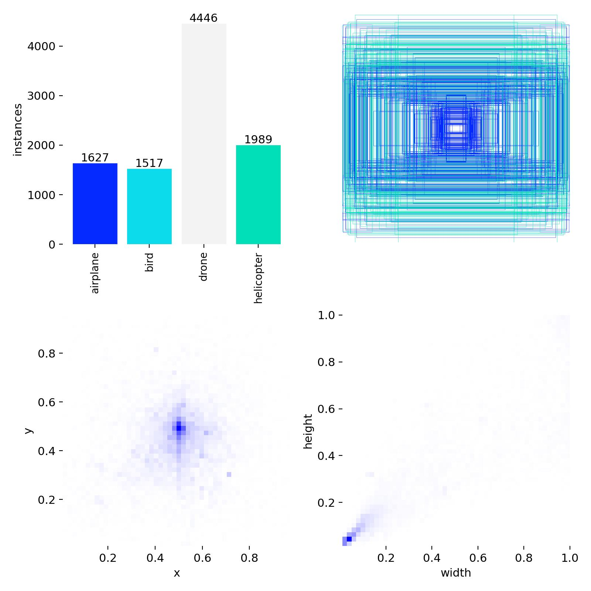
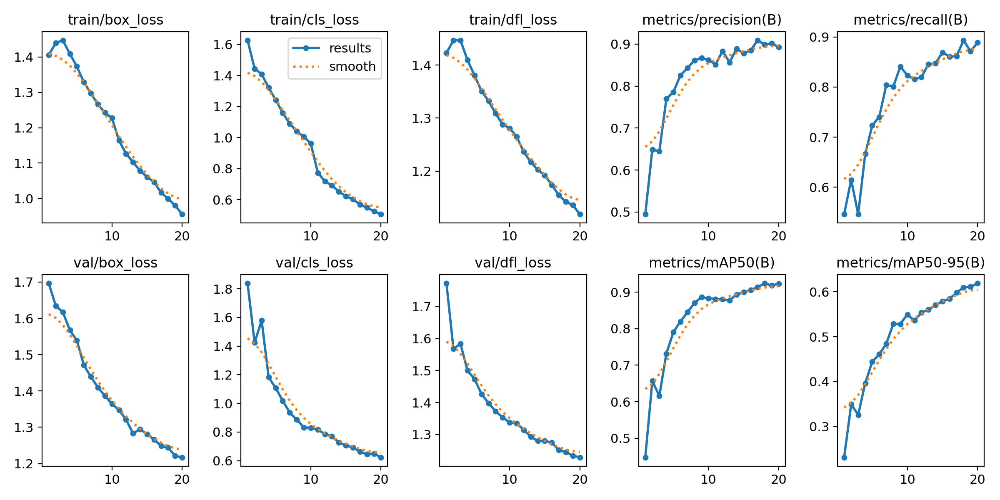
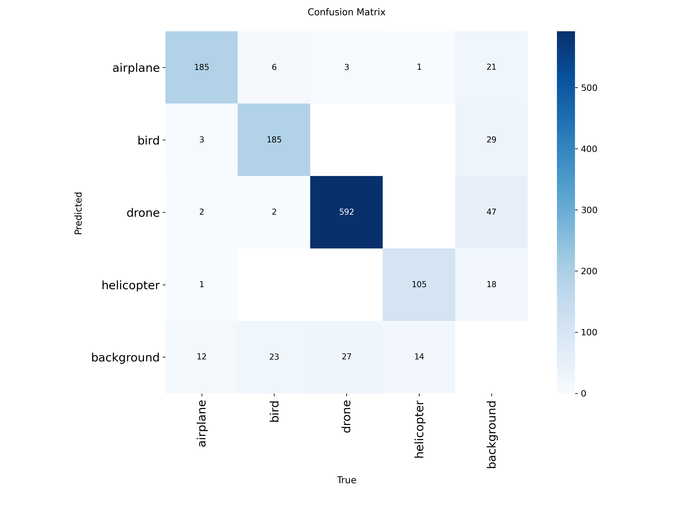
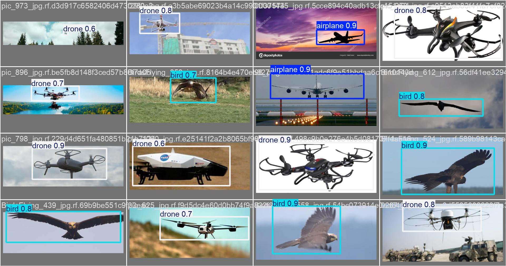

# Task 2 – Drone Detection and Classification

**Owner:** Wiame Jiber · **Backup:** Nisrine

## Goal

Detect objects in the sky from the stationary cameras and classify them as
**drone**, **bird**, **airplane** or **helicopter**. Each detection reports the
class, a confidence value and a bounding box. These are sent as events to the
backend (Task 3) and the pan-tilt camera (Task 6).

## Planned pipeline

```
Camera frame (Task 1)
  → motion detection / background subtraction
  → region of interest (crop moving area)
  → YOLO object detection
  → temporal confirmation (e.g. 3 of 5 frames)
  → detection event → backend (Task 3) + pan-tilt (Task 6)
```

## Dataset

The dataset is managed in Roboflow (workspace `jiber-wiam`, project
`drone-bird-plane-heli`). **It is not stored in Git** (team rule 6).

| Source | Images | Classes | License |
|---|---|---|---|
| Drone Detection (Rohit Gopalan, Roboflow Universe) | 5,382 | drone | CC BY 4.0 |
| Airplane+heli+bird (Mirkos Workspace, Roboflow Universe) | 5,660 | airplane, helicopter, bird | CC BY 4.0 |
| Own recordings with project webcams | *planned* | negatives (sky, birds, airplanes) | – |

Both public datasets were merged in Roboflow. The Italian class names of the
second dataset were renamed (aereo → airplane, elicottero → helicopter,
uccello → bird).

**Dataset version v1 (`v1-baseline`):**

| | Value |
|---|---|
| Images | 11,042 |
| Annotations | 13,011 |
| Background images (no object) | 291 |
| Split | 8,225 train / 1,847 valid / 970 test |
| Preprocessing | Auto-Orient |
| Augmentation (Roboflow) | none |

Boxes per class:

| Class | Boxes |
|---|---|
| drone | 6,334 |
| helicopter | 2,328 |
| airplane | 2,239 |
| bird | 2,110 |

The label overview (training set) shows the class counts, where the boxes are
in the image and how big they are:



**Known limitations of v1:**

- Drones are about 3× more frequent than the other classes.
- Birds, airplanes and helicopters are mostly large/close-up, while our cameras
  will see small, distant objects.
- Many drone images are frames from the same videos, so test results may be
  optimistic.
- No images from our own hardware yet (required by the task, planned for v2).

## Training

Training runs in Google Colab (Tesla T4 GPU) with Ultralytics YOLO.

| Parameter | Value |
|---|---|
| Base model | YOLOv8n (pretrained on COCO) |
| Epochs | 20 (early stopping, patience 10) |
| Image size | 640 |
| Batch size | 16 |
| Optimizer | AdamW (auto) |

```python
from ultralytics import YOLO

model = YOLO("yolov8n.pt")
model.train(
    data="drone-bird-plane-heli-1/data.yaml",
    epochs=20, imgsz=640, batch=16, patience=10,
    name="v1-baseline",
)
```

Model weights (`.pt`) are stored in Google Drive, **not in Git**.

## Results (v1-baseline)

Training finished after 20 epochs in 51 minutes on a Tesla T4. The best
weights are stored in Google Drive (`drone_runs/v1-baseline/weights/best.pt`,
6.5 MB).

The training curves show the losses going down and precision, recall and mAP
going up over the 20 epochs. The curves are still rising slightly at the end,
so more epochs could improve the model a little.



### Test set (970 images, not used for training)

| Class | Precision | Recall | F1 | mAP50 | mAP50-95 |
|---|---|---|---|---|---|
| **all** | 0.925 | 0.877 | **0.900** | **0.923** | 0.636 |
| drone | 0.958 | 0.936 | 0.947 | 0.966 | 0.556 |
| airplane | 0.911 | 0.910 | 0.910 | 0.937 | 0.740 |
| bird | 0.922 | 0.820 | 0.868 | 0.899 | 0.613 |
| helicopter | 0.909 | 0.842 | 0.874 | 0.891 | 0.635 |

F1 = 2 · P · R / (P + R). Validation results were almost identical
(mAP50 0.923), so the model does not overfit the training data.

Inference speed on the T4 GPU: about 3 ms per image. Speed on the
Raspberry Pi 5 + Hailo-8 is still to be measured.

### Confusion matrix (test set, confidence ≥ 0.25)

Rows = predicted class, columns = true class.

| Predicted ↓ / True → | airplane | bird | drone | helicopter | background |
|---|---|---|---|---|---|
| **airplane** | **185** | 6 | 3 | 1 | 21 |
| **bird** | 3 | **185** | 0 | 0 | 29 |
| **drone** | 2 | 2 | **592** | 0 | 47 |
| **helicopter** | 1 | 0 | 0 | **105** | 18 |
| **background** (missed) | 12 | 23 | 27 | 14 | – |



**Findings:**

- 592 of 622 drones (95 %) are detected. 27 drones are missed.
- The classes are rarely confused with each other: only 2 birds and 2
  airplanes are predicted as drones.
- Most errors are **false detections on background**: 47 "drone" predictions
  where there is no object, i.e. about 5 % of the test images.
- 23 of 216 birds are missed.

**Why this matters for the pipeline:** at 10 frames per second, a 5 %
false detection rate per frame would cause several false alarms per minute.
Single-frame detections therefore cannot trigger an alarm directly. Motion
detection (only check moving regions) and temporal confirmation (e.g. 3 of 5
frames) are needed to reduce false alarms. False alarms per observation hour
will be measured on the real system.

**Caveat:** test and training images come from the same public datasets (partly
from the same videos). Results on our own cameras with small, distant objects
are expected to be lower. This will be checked with own recordings (v2).

### Example predictions

Predictions of the v1 model on validation images (class and confidence):



## Target hardware

From Task 1 (`docs/task1-sensor-node/part-b-cameras.md`, branch `task1-sensor-node`):

| Item | Value |
|---|---|
| Edge device | Raspberry Pi 5 (8 GB) with AI HAT+ (**Hailo-8**) |
| Overview cameras | 2× Logitech MX Brio (USB 2.0), test images at 1920×1080 |
| Additional camera | Raspberry Pi AI Camera (Sony IMX500) |

Own training images must be recorded with the MX Brio cameras at the
resolution Task 1 uses in the final setup. Task 1 notes that the bright sky is
partly overexposed with automatic exposure, so recordings should also cover
manual exposure settings.

## Interface to the backend (Task 3)

The backend (`backend/app/main.py`) accepts detections at `POST /events`
(form data, API key required):

| Field | Type | Filled by Task 2 |
|---|---|---|
| `camera_id` | text | camera that saw the object |
| `object_type` | text | `drone`, `bird`, `airplane` or `helicopter` |
| `confidence` | 0–1 | model confidence |
| `event_id` | UUID (optional) | generated per event |
| `detected_at` | timestamp with timezone (optional) | frame time |
| `tracking_id` | text (optional) | ID of the confirmed track |
| `media` | file (optional) | image of the detection |

**Open point:** the event has no bounding box. Task 6 (pan-tilt) needs the box
position to compute pan/tilt angles. To be agreed with Harsh (Task 3) and
Tomer (Task 6).

## Next steps

- [x] Train v1 baseline (YOLOv8n, public data)
- [x] Evaluate v1 on the test set (metrics + confusion matrix)
- [ ] Record own images with the MX Brio cameras (settings from Task 1)
- [ ] Train v2 with public + own data, compare with v1
- [ ] Deploy to Raspberry Pi 5 + AI HAT+ (Hailo-8)
- [ ] Implement motion detection and temporal confirmation
- [ ] Measure false alarms per observation hour and FPS on the Pi
- [ ] Agree on bounding box field with Task 3 and Task 6
